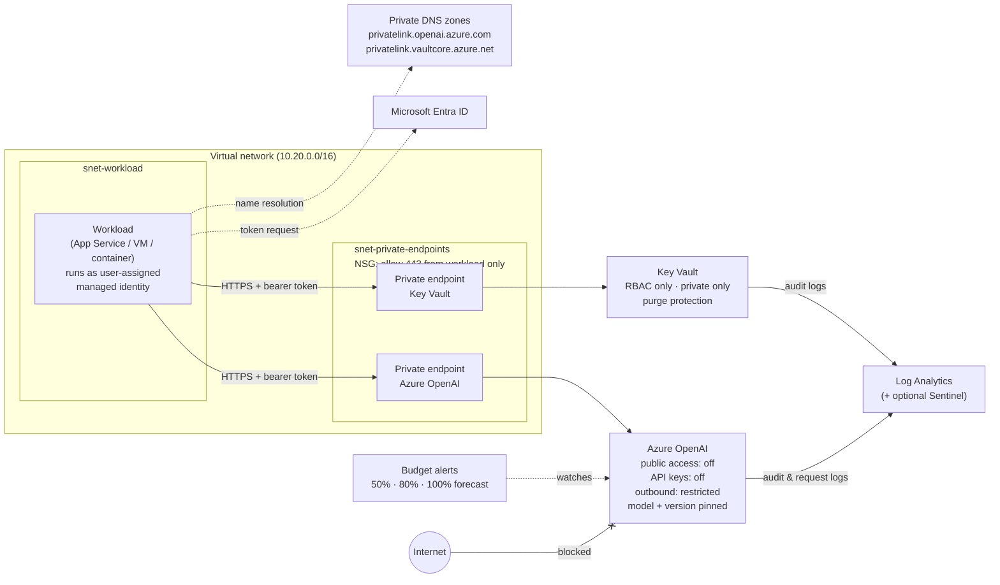

# Architecture

## Request flow

1. The workload asks Entra ID for a token for `https://cognitiveservices.azure.com` using its managed identity. No secret is involved.
2. It resolves `<account>.openai.azure.com`. The linked private DNS zone returns the private endpoint's IP.
3. The call travels over HTTPS to the private endpoint. The NSG admits it because it comes from the workload subnet.
4. Azure OpenAI validates the token and checks the caller holds *Cognitive Services OpenAI User* on the account.
5. The request and its outcome are logged to Log Analytics.

Any call from outside the VNet, or with an API key, fails at step 3 or 4.

## Module map

| Module | Creates |
|---|---|
| `monitoring.bicep` | Log Analytics workspace, optional Sentinel onboarding |
| `network.bicep` | VNet, two subnets, two NSGs |
| `identity.bicep` | User-assigned managed identity for the workload |
| `private-dns.bicep` | Private DNS zone + VNet link (used twice) |
| `openai.bicep` | Azure OpenAI account, model deployment, role assignment, diagnostics |
| `keyvault.bicep` | Key Vault, role assignment, diagnostics |
| `private-endpoint.bicep` | Private endpoint + DNS registration (used twice) |
| `budget.bicep` | Monthly budget with three alerts |
